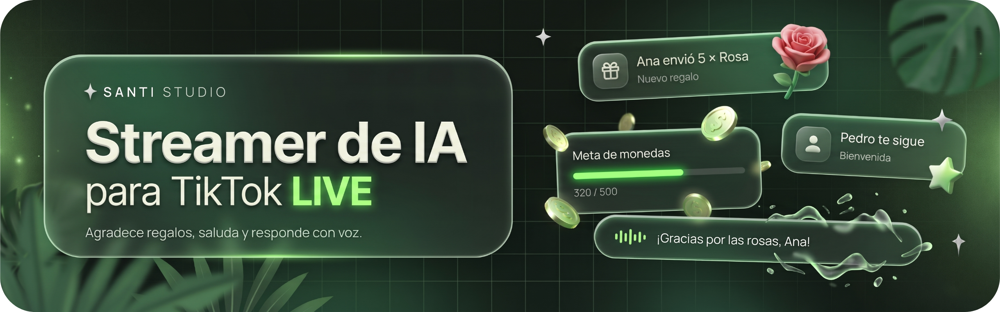

<p align="center">
  
</p>

<p align="center">
  <a href="https://youtu.be/KtRWbPz1fiU"></a>
  
  
  
</p>

Crie seu próprio personagem animado com IA que **agradece presentes, dá as boas-vindas aos seus novos seguidores e responde a comentários em tempo real**, com voz, legendas, metas e avisos na tela. Tudo com ferramentas gratuitas.

Projeto do tutorial de **Santi Studio** no YouTube ([@SantiStudioOficial](https://www.youtube.com/@SantiStudioOficial)).

## O que ele faz

| Recurso | O que faz |
|---|---|
| **Presentes** | Agradece cada presente pelo nome e responde à próxima mensagem de quem enviou. |
| **Fila VIP** | Presentes grandes (100+ moedas) furam a fila com prioridade máxima e ganham destaque especial `👑 VIP`. |
| **Ranking de Apoiadores** | Classificação em tempo real dos maiores doadores (Top Gifters) da live, com pódio no painel e exibição do #1 na tela. |
| **Seguidores** | Dá as boas-vindas a quem começa a seguir você e agrupa várias pessoas em uma única fala. |
| **Voz** | Fala com voz natural brasileira e sincroniza o movimento da boca com o áudio. |
| **Legendas** | Digitadas em tempo real no ritmo da fala, com painel indicando quem está sendo respondido. |
| **Metas** | Metas de moedas e de seguidores que a personagem comemora quando são batidas. |
| **Confetes** | Chuva de confetes coloridos na tela ao bater metas ou receber presentes grandes. |
| **Anti-Silêncio** | Puxa assunto automaticamente com o chat para a live nunca ficar em vácuo. |
| **Painel Web** | Gerencie tudo pelo navegador ou celular (`/painel`) com botões de fala rápida, sliders de som, metas e ranking. |
| **Console de Logs** | Acompanhe todos os eventos, avisos e logs do terminal em tempo real diretamente pelo painel web. |
| **Filtros** | Bloqueio de palavrões e nomes ofensivos, com regras adequadas para um público amplo. |
| **Backup** | Se uma IA falhar ou atingir o limite, tenta a próxima; se todas falharem, usa frases de backup. A live nunca fica em silêncio. |

## Do que você precisa

| Ferramenta | Para que serve |
|---|---|
| PC com **Windows** | Rodar o projeto. |
| **Python 3.10 ou mais novo** ([python.org](https://www.python.org/downloads/)) | Na instalação, marque a caixa **"Add python.exe to PATH"**. |
| Conta no TikTok com acesso a transmissões e **TikTok LIVE Studio** | Fazer a transmissão ao vivo. |
| **TikFinity Desktop** ([tikfinity.zerody.one](https://tikfinity.zerody.one)) | Ler os eventos da live. É necessário o aplicativo para desktop, não apenas o site. |
| **OBS Studio** | Câmera virtual e captura de cena. |
| Chave gratuita do **Gemini** ([aistudio.google.com](https://aistudio.google.com)) | A IA principal que gera as respostas. |
| Chave gratuita do **Groq** ([console.groq.com](https://console.groq.com)) | Backup da IA, altamente recomendado. |
| **DeepSeek** (ou outra IA de texto) e **Google Flow** | Criar o personagem: imagem e vídeos. |

## Passo a passo

### 1. Crie seu personagem

Abra um novo chat no DeepSeek e cole o **[Prompt Mestre](#prompt-mestre)** (localizado no final desta página e na descrição do vídeo). Ele guiará você em 4 etapas: design, personalidade, imagem e animações.

### 2. Anime seu personagem

No Flow, gere a imagem e em seguida os dois vídeos indicados pelo DeepSeek: **repouso** e **falando**. Baixe ambos e renomeie-os exatamente como `repouso.mp4` e `falando.mp4` (ou `reposo.mp4` e `hablando.mp4`).

> [!TIP]
> Ative no Windows: **Exibir → Mostrar → Extensões de nomes de arquivos**. Caso contrário, os arquivos podem ficar com nome duplicado (ex: `falando.mp4.mp4`) e o visualizador não conseguirá carregá-los.

### 3. Prepare a pasta

1. Baixe este projeto: no botão verde **Code → Download ZIP** e descompacte os arquivos.
2. Coloque os seus dois vídeos (`repouso.mp4` e `falando.mp4`) dentro da pasta.
3. Abra `personalidade.txt` com o Bloco de Notas e cole a personalidade gerada na Etapa 2 (apague o texto de instrução que já vem no arquivo).
4. Abra `configuracao.txt` e cole:
   - Sua chave em `GEMINI_KEY =` (e a do Groq em `GROQ_KEY =`).
   - As 3 linhas de voz fornecidas pelo DeepSeek (`VOZ`, `VELOCIDADE`, `TOM`).
5. Opcional: coloque uma música **sem direitos autorais** chamada `musica.mp3`.

> [!CAUTION]
> Suas chaves de API são pessoais. Não compartilhe seu arquivo `configuracao.txt` nem o suba para a internet depois de adicionar suas chaves.

### 4. Teste o projeto

1. Dê um duplo clique em **`iniciar.bat`**. Na primeira vez, ele instalará as bibliotecas necessárias. Se o Windows exibir um aviso de proteção: clique em **Mais informações → Executar mesmo assim**.
2. Abra `http://localhost:8765` no Chrome e **dê um clique na página** para liberar o som.
3. Você pode testar pelo **Painel de Controle Web** ou pela janela preta:
   - **No navegador ou celular:** abra `http://localhost:8765/painel` para acionar falas rápidas, alterar metas em tempo real, ajustar volumes e simular eventos com um clique.
   - **Na janela preta:** digite comandos manuais:

| Comando | O que simula |
|---|---|
| `r Ana Rosa 5` | Ana te envia 5 rosas |
| `r Luis Leão` | Um presente grande |
| `f Pedro` | Pedro começa a seguir você |
| `c Ana me conta uma piada` | Ana escreve para você (só responde se antes enviou presente) |
| `d Olá a todos!` | A personagem fala esse texto exatamente (ótimo para testar na live também) |
| `v pt-BR-AntonioNeural -8% -4Hz` | Testa outra voz em tempo real |
| `meta 0` | Zera as metas |

Feche a aba do navegador quando terminar os testes.

### 5. Monte a cena

**OBS Studio**
- Configurações → Vídeo: Resolução Base e de Saída em **1080x1920** (vertical).
- Adicione uma fonte de **Navegador**: URL `http://127.0.0.1:8765/visor.html?live=1`, largura 1080, altura 1920. **Desmarque "Controlar áudio via OBS"**.
- Clique em **Iniciar Câmera Virtual** (não clique em "Iniciar Transmissão").

**TikTok LIVE Studio**
- Fonte de Câmera: selecione **OBS Virtual Camera**. Mantenha o microfone silenciado e o áudio da área de trabalho ativo.
- Mantenha apenas uma única instância da personagem aberta: não deixe o visualizador aberto no Chrome ao mesmo tempo.

**TikFinity Desktop**
- Verifique se o **Chat TTS está desativado** nas configurações do TikFinity (caso contrário, tocarão duas vozes simultâneas).

### 6. Entre ao vivo

1. No arquivo `configuracao.txt`, altere `MODO = teste` para `MODO = live` e abra o `iniciar.bat` novamente.
2. Inicie a transmissão no TikTok LIVE Studio.
3. No TikFinity, clique em **Conectar ao TikTok LIVE**. A janela preta deverá exibir a mensagem **"Conectado ao TikFinity"**.

> [!IMPORTANT]
> Durante a transmissão ao vivo, devem permanecer abertos: a janela preta do script, o OBS Studio, o TikTok LIVE Studio e o TikFinity Desktop.

## Contas novas no LIVE Studio

Se a sua conta for recente no LIVE Studio, é comum o TikTok exigir algumas etapas adicionais:

- **Exigência de câmera física:** Caso não permita iniciar sem câmera, conecte a câmera do seu celular (o LIVE Studio gera um QR Code) e adicione o personagem por uma fonte **Link** apontando para `http://127.0.0.1:8765/visor.html?live=1`. Deixe a câmera do celular visível em um canto pequeno.
- **Câmera virtual do OBS bloqueada:** Normalmente é liberada após fazer uma live de **25 minutos ou mais** diretamente pelo LIVE Studio. A liberação pode levar até 48 horas.
- **Período de avaliação de 14 dias:** Qualquer suspensão nesse período pode revogar o acesso ao LIVE Studio. Tenha cuidado redobrado com regras da comunidade.

## Problemas comuns

| Problema | Solução |
|---|---|
| "Não encontrei o Python" | Reinstale o Python marcando a opção "Add python.exe to PATH". |
| O visualizador fica com tela preta | Verifique se os vídeos se chamam exatamente `falando.mp4` e `repouso.mp4` (ou `hablando.mp4` e `reposo.mp4`). |
| O áudio não sai | Clique na página do visualizador para ativá-lo. No OBS, desmarque a opção "Controlar áudio via OBS". |
| Duas vozes falando ao mesmo tempo | Há dois visualizadores abertos simultaneamente (Chrome, OBS ou link no LIVE Studio). Mantenha apenas um aberto. |
| O LIVE Studio informa "URL inválida" | Utilize o endereço `127.0.0.1` em vez de `localhost`. |
| O OBS mostra uma personagem anterior | Propriedades da fonte de Navegador → clique em "Atualizar o cache da página atual". |
| "A porta 8765 está ocupada" | Já existe outra janela preta do script aberta. Encerre-a antes de abrir uma nova. |
| Responde com "frases de backup" | As APIs de IA gratuitas estão congestionadas ou sua chave foi inserida incorretamente. Veja o aviso na janela preta e configure o Groq como backup. |
| A boca para no meio da frase | O visualizador pula pausas automaticamente, mas se ficar perceptível, gere novamente o vídeo de fala com mais movimento contínuo. |
| "personalidade.txt está vazio" | Cole a personalidade gerada pelo DeepSeek e apague o texto entre colchetes. |

Todas as opções (metas, letreiros, legendas, filtros, música, posições) estão explicadas dentro do arquivo `configuracao.txt`. Sempre que fizer alterações, feche a janela preta e abra o `iniciar.bat` de novo.

## Arquivos do projeto

| Arquivo | Descrição |
|---|---|
| `iniciar.bat` | Instala dependências e inicia o streamer de IA. |
| `configuracao.txt` | Suas chaves de API, voz, metas, filtros e preferências. |
| `personalidade.txt` | A personalidade e história da sua personagem. |
| `script.py` | Programa principal: lê a live, processa com IA e gera a voz. |
| `visor.html` | Exibição em tela: personagem animado, legendas, metas e avisos. |
| `painel.html` | Painel de controle web para monitorar e gerenciar a live pelo PC ou celular. |

## Recomendações e responsabilidade

Este projeto possui finalidade educativa. **O modo e o local onde você o utiliza é de sua total escolha e responsabilidade**. Seguem alguns aprendizados importantes:

- O TikTok pode reduzir o alcance de transmissões que aparentem ser **conteúdo pré-gravado**. Personagens com boa dinâmica e elementos interativos em tempo real na tela ajudam a manter a live autêntica.
- **Sempre rotule sua transmissão como conteúdo gerado por IA**, especialmente com personagens realistas.
- Não utilize **personagens, músicas ou vozes protegidas por direitos autorais**.
- Mantenha os filtros de moderação ativados: seu público pode contar com menores de idade.
- Serviços gratuitos (Gemini, Groq, vozes da Microsoft Edge TTS) **podem sofrer oscilações ou ter limites alterados**. Acompanhe o consumo no painel de cada serviço.

Ferramentas de terceiros integradas: TikFinity, edge-tts (vozes neurais da Microsoft), Gemini e Groq. Este projeto não possui afiliação oficial com o TikTok nem com nenhuma dessas empresas.

## Prompt Mestre

Cole as instruções abaixo em uma conversa nova no DeepSeek. Use o botão de cópia do bloco de código para copiar tudo de uma vez.

```
Atue como meu assistente para criar um personagem animado com IA para lives do TikTok. Guie-me por etapas, uma de cada vez, e aguarde minha resposta antes de avançar. Não antecipe etapas nem altere decisões que eu já tenha aprovado.

INÍCIO. Cumprimente em uma linha e pergunte: «Qual personagem você deseja criar? Escreva o nome ou descreva como preferir». Aguarde.

ETAPA 1. Verifique se a personagem possui direitos autorais de terceiros (filmes, séries, games, marcas ou pessoas reais). Se possuir, avise-me em uma linha e sugira 3 alternativas originais ou de domínio público com essência semelhante. Se for original/livre, proponha 3 opções de design próprio em estilos diferentes (por exemplo: 3D estilizado, ilustração digital, realista), sem copiar visuais famosos. Apresente-as numeradas, com uma breve descrição visual, e pergunte: «Qual você escolhe? Responda com um número». Aguarde.

ETAPA 2. Crie um nome curto e marcante para a personagem. Em seguida, escreva em um bloco de código a personalidade dela para a IA que irá controlá-la, em segunda pessoa («Você é [nome]…»): quem é, onde vive, do que gosta, como se expressa, frases características e como reage a presentes pequenos e grandes. Inclua estas regras obrigatórias:
- Responda em no máximo 2 frases curtas, mencione o nome de quem te escreveu e, se a pessoa enviou um presente, cite qual foi.
- Use seus bordões apenas de vez em quando para manter as respostas variadas.
- Nunca quebre o personagem. Se alguém perguntar se você é uma IA, admita com bom humor.
- O público pode incluir menores de idade: nada de conversas com teor sexual, palavrões, ofensas, drogas, política ou religião. Se tentarem provocar, mude de assunto de forma leve e bem-humorada.
- Não peça presentes com insistência nem faça promessas em troca.
- Não use emojis, asteriscos ou descrições de ações entre parênteses, pois todo o texto será lido em voz alta pela síntese de voz.
Logo abaixo, em outro bloco de código, defina a voz escolhendo a mais adequada desta lista de vozes neurais brasileiras:
pt-BR-FranciscaNeural (mulher, Brasil)
pt-BR-AntonioNeural (homem, Brasil)
pt-BR-ThalitaNeural (mulher, Brasil)
Use exatamente este formato, com velocidade entre -15% e +10% e tom entre -10Hz e +10Hz:
VOZ = …
VELOCIDADE = …
TOM = …
Finalize dizendo: «Cole a personalidade no arquivo personalidade.txt e a voz no arquivo configuracao.txt. Depois digite SEGUINTE para criarmos a imagem». Aguarde.

ETAPA 3. Escreva em um bloco de código um prompt detalhado e completo para geração de imagem vertical (proporção 9:16), começando com a linha «Gere 4 imagens diferentes com este prompt:». Descreva o personagem com o visual escolhido, centralizado e de frente para a câmera. Se tiver rosto: plano médio da cintura para cima, olhando para a câmera, boca fechada com sorriso suave, mãos fora de enquadramento ou paradas e unidas à frente. Se não tiver rosto (objeto mágico, robô, orbe): corpo inteiro em repouso. O terço superior da imagem deve ter apenas o fundo ou o topo da cabeça, mantendo o rosto perto do centro da imagem. Ao fundo, um ambiente simples com 1 ou 2 elementos sutis de movimento (ex: chama de vela, luz ambiente suave, fumaça leve), sem objetos caindo ou flutuando e sem distrações visuais. Iluminação suave. Sem textos, logotipos ou marcas d'água.
Finalize dizendo: «Escolha a imagem que mais gostou: personagem nítido e sem cortes. Digite SEGUINTE para gerarmos as animações». Aguarde.

ETAPA 4. Escreva dois prompts de vídeo adaptados ao personagem, cada um em seu próprio bloco de código, iniciando com a linha «Gere um vídeo de 6 segundos com este prompt. Use a imagem como primeiro quadro e também como último quadro:». Os dois prompts devem conter sempre: câmera perfeitamente fixa, sem zoom nem panorâmica; início e fim exatamente na mesma pose para repetição em loop contínuo; mãos imóveis; fundo com movimento suave e sutil; nenhum elemento adicionado ou retirado.
1. REPOUSO: calmo e em silêncio, sem voz ou música, apenas leve som ambiente, com movimentos contínuos e sutis, nunca totalmente estático. Se tiver rosto: respiração suave, leve inclinação de cabeça e piscar de olhos lento, boca fechada e imóvel durante todo o vídeo. Se não tiver rosto: pulsação ou rotação suave.
2. FALANDO: como se estivesse conversando continuamente, sem voz ou música, movimentando-se desde o primeiro instante até o último meio segundo. Se tiver boca: abrindo e fechando com naturalidade ao longo de todo o vídeo, com expressões amigáveis. Se não tiver boca: pulsando, vibrando ou ondulando com intensidade e variação rítmica, semelhante a um visualizador de áudio.
Antes dos blocos diga: «Arraste a imagem escolhida para o chat do Flow, cole o prompt de REPOUSO e confira o resultado antes de gerar o vídeo FALANDO». Após os blocos diga: «Baixe os dois vídeos gerados e salve-os na pasta do projeto com os nomes repouso.mp4 e falando.mp4 (certifique-se de que a extensão não fique duplicada como falando.mp4.mp4)».

Comece agora pelo INÍCIO.
```

---

<p align="center"><sub>IA explicada de forma simples e direta. · <a href="https://www.youtube.com/@SantiStudioOficial">youtube.com/@SantiStudioOficial</a></sub></p>
